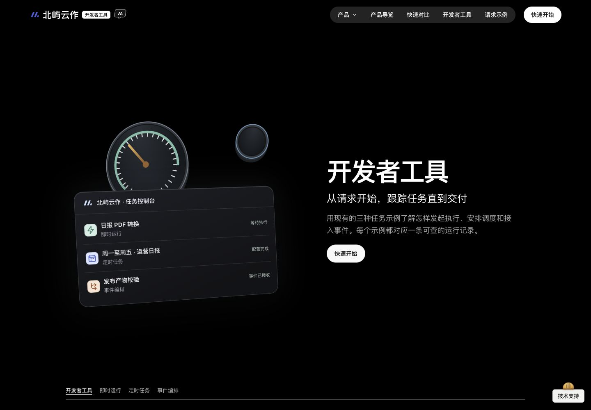
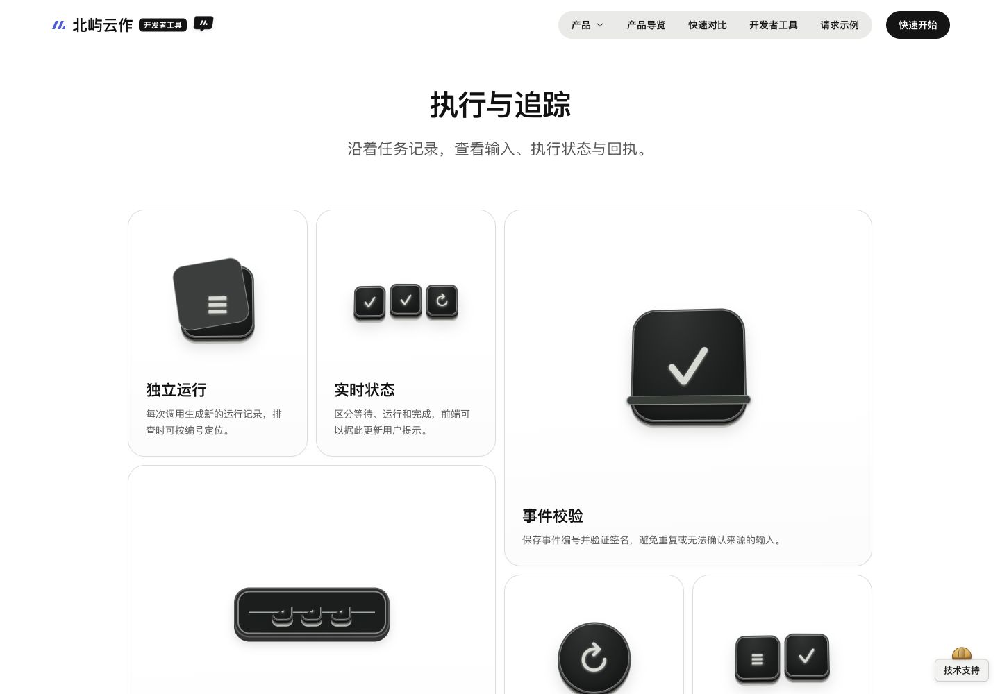

# aipay-web-design

用 Codex 给自己的产品、开发者平台或个人简历做网站。这个 Skill 把支付宝 AI 付官网公开可见的设计与交互拆成可复用的组件，配有一套可以直接运行的虚构产品示例「北屿云作」。模板使用 HTML、CSS 和 JavaScript，适合按需取用整页或单个组件。 [设计参考](https://aipay.alipay.com/)

## 在 Codex 安装

把下面这句话发给 Codex，安装完成后在下一轮对话中调用。

```text
用 $skill-installer 从 EasonYan7/skills 的 main 分支安装 skills/aipay-web-design。
```

## 复制提示词开始做网站

把方括号换成你的信息。做简历官网时，可以直接附上简历 PDF 或粘贴原文。

```text
请使用 $aipay-web-design，设计并实现一个[产品官网 / 个人简历网站]。

- 网站名称：[产品名或你的名字]
- 目标访客：[潜在客户 / 招聘经理 / 合作伙伴]
- 希望访客做的事：[预约演示 / 注册试用 / 查看作品 / 联系我]
- 已有材料：[产品介绍、截图、简历、作品链接或联系方式]
- 视觉偏好：[简洁、有质感、动效克制，或附上参考链接]

产品官网首屏讲清产品帮谁解决什么问题，随后展示使用场景和核心功能。简历官网首屏讲清我的定位，随后用代表项目、职责和成果呈现我的能力。

按内容选用 Skill 里的导航、滚动换场和卡片动效。产品数据、工作经历和项目成果以我提供的材料为准。请直接实现页面，检查桌面与手机布局、按钮和链接，并给我一个可打开的本地预览地址。
```

## 运行「北屿云作」示例

电脑需要 Python 3。克隆仓库后运行预览脚本。

```sh
git clone https://github.com/EasonYan7/skills.git
cd skills
python3 skills/aipay-web-design/scripts/preview.py
```

打开终端打印的地址。默认入口是 [本地首页](http://127.0.0.1:8765/)，也可以直达 [开发者换场](http://127.0.0.1:8765/#tools-intro) 或 [立体卡片](http://127.0.0.1:8765/#reliability)。桌面向下滚动可以看到画面横向切换。手机布局随内容纵向排列。





组件包括首屏标题轮换、响应式导航、产品滚动区、对比表、开发者横向换场、滚动助手、立体卡片和收尾页脚。需要单独集成组件时，可以查看 [组件模板](assets/frontend-template/) 和 [组件接入说明](references/components.md)。

模板采用独立实现的示例品牌、任务数据与交互。参考页面、观测记录和实现差异见 [来源与取证](references/source.md) 和 [动效说明](references/motion.md)。
